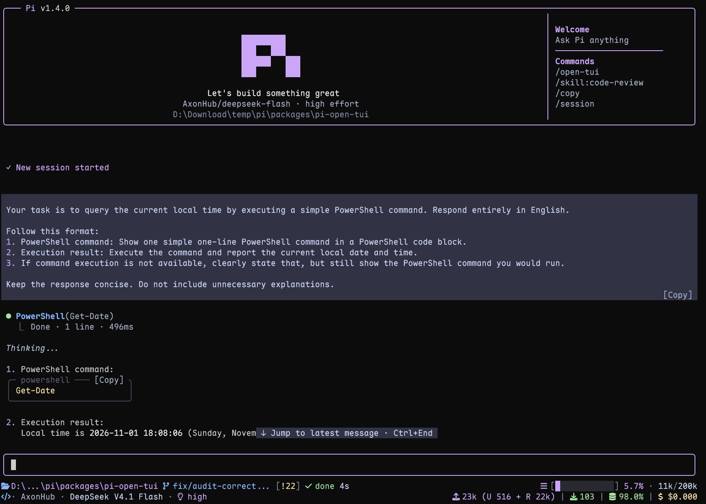

# pi-open-tui

[](https://omppackages.com/packages/pi-open-tui)

**English** | [简体中文](./README.zh-CN.md)

A polished terminal interface for the [Pi](https://pi.dev) coding agent.



## Highlights

- **Pi header** with model, thinking level, working directory, and useful slash-command hints
- **Responsive footer** with Git state, detected runtime, context usage, tokens, cost, and extension status
- **Framed editor** with block, bar, and underline cursors, preserving compatible editors from other extensions
- **Project awareness** for 50+ runtimes and detailed Git state, including ahead/behind, staged, modified, untracked, stash, and detached HEAD
- **Turn telemetry** with generation speed, time to first token, duration, stalls, tokens, and cost rate
- **Thinking peek** with a live preview of hidden reasoning while the model works
- **Compact tool view** with edit/write previews and optional support for extension and MCP tools
- **Fullscreen Copy buttons** for code blocks and user messages
- **Interactive settings** in English and Simplified Chinese through `/open-tui`

## Requirements

- Pi 1.5.0 or later
- Node.js 22.19.0 or later (Pi's minimum)
- A terminal with UTF-8 and color support
- A [Nerd Font](https://www.nerdfonts.com/font-downloads) for the full icon set (optional; Unicode and ASCII modes are available)

## Install

Install the extension:

```bash
pi install npm:pi-open-tui
```

Or try it for one session:

```bash
pi -e npm:pi-open-tui
```

## Font and icons

For the full icon set, install a [Nerd Font](https://www.nerdfonts.com/font-downloads), select it in your terminal profile, and restart the terminal. Installing the font in the OS alone is not enough for apps such as VS Code or Windows Terminal.

In `/open-tui`, **Appearance → Icons** offers `auto`, `nerd`, `unicode`, and `ascii`. The default `auto` mode checks the terminal environment, not the installed font. If icons appear as boxes, choose `unicode`; if your terminal has a Nerd Font, you can force `nerd`, including over SSH.

See [icon detection and spacing](./docs/configuration.md#icons) for automatic selection rules and the Kitty spacing option.

## Configuration

Run `/open-tui` to open the settings dialog. Its **General**, **Appearance**, **Footer**, and **Telemetry** tabs are available in English and Simplified Chinese and adapt to the terminal size. Use Tab/Shift+Tab or ←/→ to switch tabs, ↑/↓ to move, Enter/Space to change a value, and Esc/q to close.

Settings are stored in `open-tui.json` inside Pi's agent directory (default: `~/.pi/agent`; overridden by `PI_CODING_AGENT_DIR`). If saving fails, a warning explains that the change applies only to the current session.

| Setting | Where to find it | Default |
| --- | --- | --- |
| Header and settings language | General → Interface | Header on, English |
| Thinking peek | General → Messages & tools | 1 line |
| Copy buttons | General → Messages & tools | On, fullscreen only |
| Tool view | General → Messages & tools | Native |
| Footer in editor border | General → Footer | Off |
| Icons and cursor style | Appearance | Auto icons, block cursor |
| Footer fields and telemetry measurements | Footer / Telemetry | Individually configurable |

Selecting **Tool view: Compact** reveals **Compact extension tools** as a child setting. Switching back to Native hides it and retains its value. The [configuration reference](./docs/configuration.md#english) contains the complete JSON defaults, every option, and tool exclusions.

## Header, footer, and editor

The header provides model and project context with command hints. The two main footer rows keep location, Git state, runtime, a working/done timer, context usage, model details, tokens, and cost visible as space allows. Fields can be toggled individually; the layout shortens or hides lower-priority information in narrow terminals.

Git status refreshes after tool execution, including commits on the current branch. Rapid tool activity is combined into periodic refreshes, with any pending refresh expedited when the agent run ends.

Footer token and cost totals include assistant responses, tool-reported usage, compaction and branch summaries, and cache warming. The cache-hit percentage describes the latest assistant response. Other extensions can use separate status rows or [contribute text directly to the main footer](./docs/footer-segments.md).

Enable **Footer in editor border** to move the two main rows into the editor's top and bottom borders. Extension status rows remain below the editor. Compatible editors keep their input behavior, completion, and ghost text; editors that cannot be framed retain a separate footer. See [editor compatibility and layout](./docs/implementation.md#editor-and-layout) for the integration boundaries.

## Turn telemetry

After each complete agent run, pi-open-tui shows one transient result, combining its assistant turns:

```text
> TPS 42.5 tok/s | ~ TTFT 1.2s | + 29.7s | ↑ 567 | ↓ 1.2k | ! stall 1x / 4.3s | $ $3.60/M
```

TPS measures provider-reported output tokens over generation time, including waiting and stalls but excluding tool execution between turns. The working timer also shows an estimated live speed such as `~54 tok/s` during streaming. The `$ / M` field is the effective rate per million tokens for the run; the footer shows cumulative session cost.

Toggle notification fields under **Telemetry → Measurements**, or live speed under **Footer → Runtime → Live TPS**. See [measurement definitions](./docs/implementation.md#usage-and-telemetry) for formulas, timing boundaries, and cache accounting.

## Thinking peek

With Pi's **Hide thinking** enabled, pi-open-tui replaces the hidden block's `Thinking...` label with the latest reasoning tail while the model works:

```text
~ think ⠋ previous thought
          latest thought
```

Choose **Off**, **1 line**, or **2 lines** under **General → Messages & tools → Thinking peek**. The ticker appears only when the model streams reasoning, settles on a check mark when the answer begins, and returns to Pi's native label after the task settles. It follows Pi's Hide thinking toggle immediately and clips text to fit the available width.

## Tool view

**Native** remains the default. Select **General → Messages & tools → Tool view → Compact** to display Pi's built-in tools (`read`, `bash`, `powershell`, `edit`, `write`, `grep`, `find`, `ls`, and the opt-in `codemode` and `tool_search`) as call and summary rows:

```text
● Read(extensions/open-tui/footer.ts:1-120)
  └  120 lines
● Edit(extensions/open-tui/footer.ts)
  └  +2 −1
● Bash(npm test)
  └  Done · 131 lines · 6.4s
● Codemode(const results = await Promise.allSettled([ … (+3 lines))
  ├  ✓ Read(src/config.ts) · 12ms
  ├  ✓ Find(*test.ts) · 18ms
  ├  ✓ Bash(npm test) · 2.6s
  └  Done · 3 calls · 2.7s
     42 tests passed
● Tool Search(browser screenshot)
  └  Loaded 3 tools · 24ms
     browser_snapshot · browser_click · browser_screenshot
```

- Successful `edit` and `write` calls show syntax-highlighted previews of up to 16 rows, with a hint to expand longer output.
- Running shell calls show recent output and elapsed time; errors retain their error summary.
- `codemode` shows up to three recent nested calls with status, arguments, and duration, followed by the script status, total call counts, elapsed time, and one output or error line. Image counts and output truncation remain visible; expand to see earlier calls and full output. Its call detail skips the optional script options header.
- `tool_search` shows the number of loaded tools and up to three tool names, with an expansion hint for more. Neither tool requires **Compact extension tools**.
- Click a row to expand its native card, or use `Ctrl+O` to expand all rows. Tools, arguments, results, and model-visible content are unchanged.
- Enable **Compact extension tools** to include extension and MCP tools. Use `toolView.exclude` in the config file for tools that should keep native rendering. Recognized `@ff-labs/pi-fff` tools receive search-specific summaries.
- Changing the mode affects newly created rows. Use `/reload` or a new session to apply it to the whole transcript.

See [tool rendering details](./docs/implementation.md#tool-rendering) for preview rules, extension summaries, and renderer compatibility.

## Copy buttons

In fullscreen mode (Pi's `tuiMode: "fullscreen"`), completed code blocks show a clickable `[Copy]` label in their rounded frame when there is enough width. User messages have a Copy label too. Clicking copies the source text and Pi flashes `Copied!`.

```text
╭─ sh ─────────────── [Copy] ╮
│ pi install npm:pi-open-tui │
╰────────────────────────────╯
```

Code labels copy code without fences, preserving indentation and tabs. User-message labels copy the original message. Streaming code blocks gain their label when streaming finishes; regular mode and thinking blocks keep Pi's plain fences. Use Pi's `/copy` to copy a whole assistant reply.

Toggle **General → Messages & tools → Copy buttons** to enable or disable this feature. [Copy-button details](./docs/implementation.md#copy-button-behavior) cover width limits, cached blocks, and interaction with other renderers.

## Documentation

- [Configuration reference](./docs/configuration.md#english) — complete defaults, options, and icon selection
- [Implementation and compatibility](./docs/implementation.md#english) — measurement formulas, layout, rendering, and lifecycle
- [Extension footer segments](./docs/footer-segments.md) — public events and an integration example for extension authors
- [Changelog](./CHANGELOG.md) — released and upcoming changes

## Local development

```bash
npm install
npm test
npm run typecheck
pi -e .
```

CI checks Pi 1.5.0 and the latest release on Node.js 22.19.0 and 24 across Linux, Windows, and macOS. Keep all Pi packages on the same version. Use `pi -e .` to check terminal fonts, mouse interaction, and cursor support interactively.

## Acknowledgements

This project builds on several Pi community packages:

- **[pi-haiku](https://github.com/nnocte/pi-haiku)** — two-line footer structure and working timer
- **[pi-claude-code-tui](https://github.com/Phoobobo/pi-claude-code-tui)** — Pi logo artwork and rounded editor border technique
- **[pi-zentui](https://github.com/lmilojevicc/pi-zentui)** — Starship-style footer segments, runtime detection, session lifecycle, and settings UI pattern
- **[pi-tps](https://github.com/monotykamary/pi-tps)** — turn timing, stall detection, and conservative TPS measurement
- **[pi-polish](https://github.com/Pringled/pi-extensions/blob/main/packages/pi-polish)** — compact tool-call rows and syntax-highlighted edit diffs

The logo artwork is derived from Pi's official install script (`pi.dev/install.sh`). Runtime detection and Git porcelain parsing borrow structure from `pi-zentui`.

Special thanks to the **[LINUX DO](https://linux.do)** community for its support.

## License

[MIT](./LICENSE)
