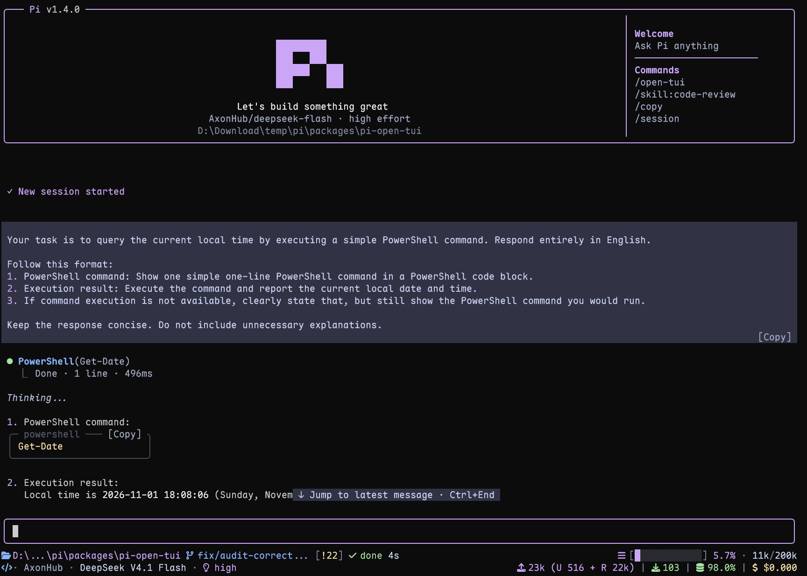

# pi-open-tui

[](https://omppackages.com/packages/pi-open-tui)

[English](./README.md) | **简体中文**

一个为 [Pi](https://pi.dev) 编程代理打造的终端界面扩展。



## 功能亮点

- **Pi 顶栏**：显示模型、思考等级、当前目录和常用斜杠命令提示
- **自适应底栏**：展示 Git 状态、运行环境、上下文用量、Token、费用和扩展状态
- **带边框的编辑器**：支持块状、竖线和下划线光标，保留其他扩展的兼容编辑器
- **项目环境感知**：识别 50 多种运行环境，并展示 ahead/behind、已暂存、已修改、未跟踪、stash 和分离 HEAD 等 Git 状态
- **单轮遥测**：展示生成速度、首 Token 延迟、耗时、停顿、Token 数量和费用速率
- **思考预览**：模型工作时实时预览隐藏的推理内容
- **紧凑工具视图**：提供编辑/写入预览，可选支持扩展和 MCP 工具
- **全屏复制按钮**：一键复制代码块和用户消息
- **交互式设置**：通过 `/open-tui` 使用英文或简体中文界面

## 环境要求

- Pi 1.5.0 或更高版本
- Node.js 22.19.0 或更高版本（Pi 的最低要求）
- 支持 UTF-8 和彩色输出的终端
- 使用完整图标集时需要 [Nerd Font](https://www.nerdfonts.com/font-downloads)（可选，也可使用 Unicode 或 ASCII 模式）

## 安装

安装扩展：

```bash
pi install npm:pi-open-tui
```

也可以只在当前会话中试用：

```bash
pi -e npm:pi-open-tui
```

## 字体与图标

使用完整图标集时，请安装 [Nerd Font](https://www.nerdfonts.com/font-downloads)，在终端配置中选中它并重启终端。使用 VS Code、Windows Terminal 等应用时，只在操作系统中安装字体还不够。

`/open-tui` 的**外观 → 图标**提供 `auto`、`nerd`、`unicode` 和 `ascii`。默认 `auto` 检查终端环境，并不检查实际字体；图标显示为方框时可选 `unicode`，终端已配置 Nerd Font 时可强制选 `nerd`，SSH 会话同样适用。

自动选择规则和 Kitty 的间距选项见[图标检测与间距](./docs/configuration.md#图标)。

## 配置

运行 `/open-tui` 打开设置窗口，包含**常规**、**外观**、**底栏**和**遥测**四个页面，支持英文和简体中文，并适应终端尺寸。Tab/Shift+Tab 或 ←/→ 切页，↑/↓ 移动，Enter/Space 修改值，Esc/q 关闭。

设置保存在 Pi 的 agent 目录内的 `open-tui.json` 中，默认目录是 `~/.pi/agent`，可通过 `PI_CODING_AGENT_DIR` 覆盖。保存失败时会提示：修改仅在当前会话生效。

| 设置 | 位置 | 默认值 |
| --- | --- | --- |
| 顶栏与设置语言 | 常规 → 界面 | 顶栏开启、英文 |
| 思考预览 | 常规 → 消息与工具 | 单行 |
| 复制按钮 | 常规 → 消息与工具 | 开启，仅全屏模式 |
| 工具视图 | 常规 → 消息与工具 | 原生 |
| 底栏嵌入输入框 | 常规 → 底栏 | 关闭 |
| 图标与光标样式 | 外观 | 自动图标、块状光标 |
| 底栏字段与遥测指标 | 底栏 / 遥测 | 可分别设置 |

选择**工具视图：紧凑**后，才会显示子选项**紧凑显示扩展工具**；切回原生时隐藏该选项并保留其值。完整 JSON 默认配置、所有选项和工具排除列表见[配置参考](./docs/configuration.md#简体中文)。

## 顶栏、底栏与编辑器

顶栏提供模型、项目环境和命令提示。两条主底栏集中显示位置、Git 状态、运行环境、工作/完成计时器、上下文用量、模型详情、Token 和费用。可单独开关各项字段；终端变窄时，布局会缩短或隐藏低优先级信息。

底栏 Token 和费用总计包含助手回复、工具报告的用量、压缩与分支摘要以及缓存预热；缓存命中率表示最近一条助手回复。其他扩展可以使用独立状态行，也可以[直接向主底栏添加内容](./docs/footer-segments.md)。

开启**底栏嵌入输入框**，可把两条主信息行移入编辑器上下边框，扩展状态行仍显示在编辑器下方。兼容编辑器会保留输入行为、补全和灰字建议；无法加框的编辑器继续使用独立底栏。集成边界见[编辑器兼容性与布局](./docs/implementation.md#编辑器与布局)。

## 单轮遥测

每次 Agent 完整运行结束后，pi-open-tui 会合并其中的助手轮次，显示一条临时结果：

```text
> TPS 42.5 tok/s | ~ TTFT 1.2s | + 29.7s | ↑ 567 | ↓ 1.2k | ! stall 1x / 4.3s | $ $3.60/M
```

TPS 用服务商报告的输出 Token 除以生成时间，包含等待和停顿，不包含轮次之间的工具执行时间。流式输出期间，工作计时器还会显示 `~54 tok/s` 这样的实时估算速度。`$ / M` 表示本次运行每百万 Token 的综合费率，底栏则显示会话累计费用。

可在**遥测 → 测量指标**中开关通知字段，在**底栏 → 运行环境 → 实时 TPS**中控制实时速度。计算公式、计时边界和缓存统计见[指标定义](./docs/implementation.md#用量与遥测)。

## 思考预览

开启 Pi 的 **Hide thinking** 后，模型工作时 pi-open-tui 会用最新推理片段替换隐藏思考块的 `Thinking...` 标签：

```text
~ think ⠋ 上一条思考
          最新一条思考
```

在**常规 → 消息与工具 → 思考预览**中选择**关闭、单行或双行**。字幕仅在模型真正输出推理时出现，正文开始后变为对勾，任务结束后恢复原生标签。可见性随 Pi 的 Hide thinking 开关立即变化，文字会按可用宽度截断。

## 工具视图

默认使用**原生**模式。在**常规 → 消息与工具 → 工具视图**中选择**紧凑**后，Pi 内置工具（`read`、`bash`、`powershell`、`edit`、`write`、`grep`、`find`、`ls`，以及需要手动启用的 `codemode` 和 `tool_search`）显示为调用行和摘要行：

```text
● Read(extensions/open-tui/footer.ts:1-120)
  └  120 lines
● Edit(extensions/open-tui/footer.ts)
  └  +2 −1
● Bash(npm test)
  └  Done · 131 lines · 6.4s
● Codemode(const results = await Promise.allSettled([ … (+3 lines))
  ├  ✓ Read(src/config.ts) · 12ms
  ├  ✓ Find(*test.ts) · 18ms
  ├  ✓ Bash(npm test) · 2.6s
  └  Done · 3 calls · 2.7s
     42 tests passed
● Tool Search(browser screenshot)
  └  Loaded 3 tools · 24ms
     browser_snapshot · browser_click · browser_screenshot
```

- `edit` 和 `write` 成功后显示带语法高亮的预览，最多 16 行，较长输出会提示展开。
- Shell 运行时显示近期输出和已用时间；出错时保留错误摘要。
- `codemode` 最多显示最近三条子调用的状态、参数和耗时，随后显示脚本状态、子调用总数、已用时间及一行输出或错误。保留图片数量和输出截断提示；展开可查看更早的调用与完整输出。调用摘要跳过可选的脚本选项头。
- `tool_search` 显示已加载工具的数量与最多三个工具名，更多工具会提示展开。两者均无需开启**紧凑显示扩展工具**。
- 点击某行展开其原生卡片，`Ctrl+O` 展开全部行。工具、参数、结果和模型看到的内容都不改变。
- 开启**紧凑显示扩展工具**可包含扩展和 MCP 工具；需要保留原生显示的工具可写入配置文件中的 `toolView.exclude`。识别到的 `@ff-labs/pi-fff` 工具使用专门的搜索摘要。
- 切换模式只影响新建的行；执行 `/reload` 或新开会话后，整个记录都会应用。

预览规则、扩展摘要和渲染器兼容性见[工具渲染细节](./docs/implementation.md#工具渲染)。

## 复制按钮

全屏模式（Pi 的 `tuiMode: "fullscreen"`）下，完成的代码块会在宽度足够时，在圆角边框中显示可点击的 `[Copy]` 标签；用户消息也有复制标签。点击后复制原文，Pi 会短暂提示 `Copied!`。

```text
╭─ sh ─────────────── [Copy] ╮
│ pi install npm:pi-open-tui │
╰────────────────────────────╯
```

代码标签复制不含围栏的代码，保留缩进和制表符；用户消息标签复制输入原文。流式代码块会在输出结束后显示标签；普通模式和思考块保留 Pi 原生围栏。复制整条助手回复请使用 Pi 的 `/copy`。

可在**常规 → 消息与工具 → 复制按钮**中开关此功能。宽度限制、代码块缓存和与其他渲染器共存的细节见[复制按钮说明](./docs/implementation.md#复制按钮行为)。

## 文档

- [配置参考](./docs/configuration.md#简体中文) — 完整默认值、配置项和图标选择规则
- [实现与兼容性](./docs/implementation.md#简体中文) — 指标公式、布局、渲染和生命周期
- [扩展底栏接口（英文）](./docs/footer-segments.md) — 面向扩展开发者的公开事件和接入示例
- [更新日志](./CHANGELOG.md) — 已发布和待发布的改动

## 本地开发

```bash
npm install
npm test
npm run typecheck
pi -e .
```

CI 在 Linux、Windows、macOS 上，使用 Node.js 22.19.0 和 24 检查 Pi 1.5.0 及最新版本。核对兼容性时应让所有 Pi 包保持同一版本。终端字体、鼠标交互和光标支持可通过 `pi -e .` 实际检查。

## 致谢

本项目基于多个 Pi 社区包的工作：

- **[pi-haiku](https://github.com/nnocte/pi-haiku)** — 双行底栏结构和工作计时器
- **[pi-claude-code-tui](https://github.com/Phoobobo/pi-claude-code-tui)** — Pi Logo 图案与圆角编辑器边框技术
- **[pi-zentui](https://github.com/lmilojevicc/pi-zentui)** — Starship 风格底栏、运行环境检测、会话生命周期和设置界面模式
- **[pi-tps](https://github.com/monotykamary/pi-tps)** — 单轮计时、停顿检测和保守的 TPS 计算方式
- **[pi-polish](https://github.com/Pringled/pi-extensions/blob/main/packages/pi-polish)** — 紧凑的工具调用行和带语法高亮的编辑 diff

Logo 图案源自 Pi 官方安装脚本（`pi.dev/install.sh`）。运行环境检测和 Git porcelain 解析借鉴了 `pi-zentui` 的结构。

特别感谢 **[LINUX DO](https://linux.do)** 社区的支持。

## 许可证

[MIT](./LICENSE)
